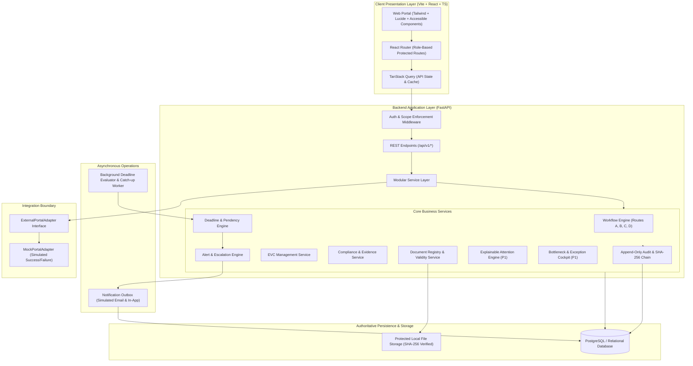

# SETU — System Architecture & Technical Design

## 1. High-Level Architecture Overview

SETU is designed as a modular, enterprise-grade government automation platform adhering to strict security, auditability, and regulatory boundaries.

---

## 2. Security & Authorization Architecture

1. **Authentication:** Passwords hashed using bcrypt. Stateless, signed JWT tokens delivered with configurable expiration.
2. **Access Control (RBAC):** 8 distinct roles defined in `docs/regulatory-rules-register.md`.
3. **Record-Level Scoping:**
   - Institution Administrator requests are strictly filtered by `institution_id = current_user.institution_id`.
   - Regional Officers are filtered by `region_id = current_user.region_id`.
   - Bureau and Competent Authority users have jurisdictional overview according to assigned workflows.
4. **Decisional Separation:** The system prevents non-statutory roles from executing statutory decisions.

---

## 3. Append-Only Audit Trail & Hash Chaining

To ensure tamper evidence:
- Every significant action inserts an `AuditEvent` with:
  `id, timestamp, actor_id, actor_role, action, entity_type, entity_id, previous_state, new_state, payload_json, previous_hash, current_hash`.
- `current_hash = SHA256(previous_hash + canonical_json(event_details))`.
- For the genesis event, `previous_hash = "0" * 64`.
- The verification endpoint iterates through all events sequentially, recomputing the hash. Any modification, insertion, or deletion breaks the chain.

---

## 4. Background Processing & Reliability

- **Scheduler:** Lightweight, non-blocking background worker evaluating deadlines every configured interval.
- **Downtime Catch-Up:** Upon startup or restart, the scheduler evaluates the entire active dataset, catching up on any missed windows, marking them as late-evaluated without duplicating previously issued alerts.
- **Idempotency:** Alerts use compound idempotency keys (`entity_type:entity_id:alert_type:window_day`). Duplicate evaluations never produce duplicate alerts.
