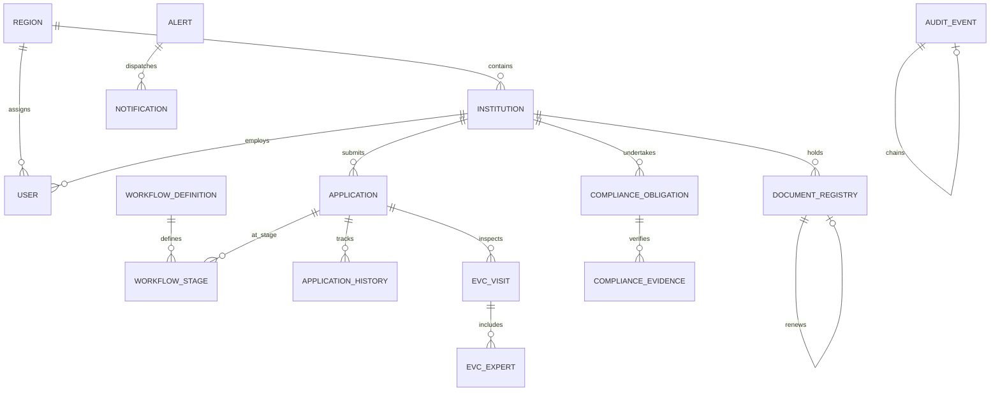

# SETU — Relational Data Model & Schema Specification

## 1. Entity-Relationship Overview

---

## 2. Table Specifications

### A. Core Master Tables
1. **`regions`**: Regional Offices of AICTE (e.g. Northern, Western, South-Western).
   - `id` (UUID PK), `code` (VARCHAR Unique), `name` (VARCHAR), `states_covered` (VARCHAR), `created_at` (TIMESTAMP TZ).
2. **`institutions`**: Technical institutions under AICTE purview.
   - `id` (UUID PK), `aicte_id` (VARCHAR Unique), `name` (VARCHAR), `region_id` (FK `regions.id`), `address` (TEXT), `district` (VARCHAR), `state` (VARCHAR), `contact_email` (VARCHAR), `contact_phone` (VARCHAR), `created_at` (TIMESTAMP TZ).
3. **`users`**: Administrative and institutional user accounts.
   - `id` (UUID PK), `email` (VARCHAR Unique), `hashed_password` (VARCHAR), `full_name` (VARCHAR), `role` (VARCHAR - 8 enum values), `institution_id` (FK `institutions.id` Nullable), `region_id` (FK `regions.id` Nullable), `is_active` (BOOLEAN), `created_at` (TIMESTAMP TZ).

### B. Workflow Engine Tables
4. **`workflow_definitions`**: Workflow route metadata (Routes A, B, C, D).
   - `id` (UUID PK), `code` (VARCHAR Unique), `name` (VARCHAR), `aph_version` (VARCHAR), `description` (TEXT), `is_active` (BOOLEAN), `created_at` (TIMESTAMP TZ).
5. **`workflow_stages`**: Stage sequence and SLA definitions.
   - `id` (UUID PK), `workflow_id` (FK `workflow_definitions.id`), `stage_key` (VARCHAR), `name` (VARCHAR), `sequence_order` (INTEGER), `sla_days` (INTEGER), `is_terminal` (BOOLEAN), `created_at` (TIMESTAMP TZ).
6. **`applications`**: Submitted institutional applications.
   - `id` (UUID PK), `application_no` (VARCHAR Unique), `institution_id` (FK `institutions.id`), `region_id` (FK `regions.id`), `academic_year` (VARCHAR), `application_type` (VARCHAR), `route` (VARCHAR), `current_stage_id` (FK `workflow_stages.id`), `status` (VARCHAR), `assigned_officer_id` (FK `users.id` Nullable), `submitted_at` (TIMESTAMP TZ), `stage_entered_at` (TIMESTAMP TZ), `current_sla_deadline` (TIMESTAMP TZ), `is_paused` (BOOLEAN Default FALSE), `return_count` (INTEGER Default 0), `created_at` (TIMESTAMP TZ), `updated_at` (TIMESTAMP TZ).
7. **`application_history`**: Chronological workflow transition ledger.
   - `id` (UUID PK), `application_id` (FK `applications.id`), `from_stage_id` (FK `workflow_stages.id` Nullable), `to_stage_id` (FK `workflow_stages.id`), `action` (VARCHAR), `actor_id` (FK `users.id`), `comments` (TEXT Nullable), `created_at` (TIMESTAMP TZ).

### C. EVC Inspection Tables
8. **`evc_visits`**: EVC inspection visits.
   - `id` (UUID PK), `application_id` (FK `applications.id`), `status` (VARCHAR), `proposed_date` (DATE Nullable), `confirmed_date` (DATE Nullable), `completed_date` (DATE Nullable), `report_submitted_date` (DATE Nullable), `report_summary` (TEXT Nullable), `coordinator_id` (FK `users.id` Nullable), `delay_reason` (TEXT Nullable), `report_file_ref` (VARCHAR Nullable), `created_at` (TIMESTAMP TZ), `updated_at` (TIMESTAMP TZ).
9. **`evc_experts`**: Visiting expert committee members.
   - `id` (UUID PK), `visit_id` (FK `evc_visits.id`), `expert_name` (VARCHAR), `designation` (VARCHAR), `organization` (VARCHAR), `contact_email` (VARCHAR), `created_at` (TIMESTAMP TZ).

### D. Compliance & Document Registry Tables
10. **`compliance_obligations`**: Time-bound approval conditions.
    - `id` (UUID PK), `application_id` (FK `applications.id` Nullable), `institution_id` (FK `institutions.id`), `category` (VARCHAR), `title` (VARCHAR), `description` (TEXT), `condition_source` (VARCHAR), `due_date` (DATE), `status` (VARCHAR), `responsible_person` (VARCHAR), `reviewer_id` (FK `users.id` Nullable), `review_comments` (TEXT Nullable), `closed_at` (TIMESTAMP TZ Nullable), `created_at` (TIMESTAMP TZ), `updated_at` (TIMESTAMP TZ).
11. **`compliance_evidences`**: Submitted compliance proofs.
    - `id` (UUID PK), `obligation_id` (FK `compliance_obligations.id`), `institution_id` (FK `institutions.id`), `file_name` (VARCHAR), `file_path` (VARCHAR), `file_size` (INTEGER), `mime_type` (VARCHAR), `sha256_hash` (VARCHAR), `notes` (TEXT Nullable), `submitted_by_id` (FK `users.id`), `verification_status` (VARCHAR Default 'SUBMITTED'), `verified_by_id` (FK `users.id` Nullable), `verified_at` (TIMESTAMP TZ Nullable), `rejection_reason` (TEXT Nullable), `created_at` (TIMESTAMP TZ).
12. **`document_registry`**: Prescribed documents & lease deeds.
    - `id` (UUID PK), `institution_id` (FK `institutions.id`), `application_id` (FK `applications.id` Nullable), `document_category` (VARCHAR), `title` (VARCHAR), `issue_date` (DATE), `expiry_date` (DATE), `current_version` (INTEGER Default 1), `status` (VARCHAR), `file_path` (VARCHAR), `file_size` (INTEGER), `mime_type` (VARCHAR), `sha256_hash` (VARCHAR), `verified_by_id` (FK `users.id` Nullable), `verified_at` (TIMESTAMP TZ Nullable), `previous_document_id` (FK `document_registry.id` Nullable), `created_at` (TIMESTAMP TZ), `updated_at` (TIMESTAMP TZ).

### E. Alert, Notification & Audit Tables
13. **`alerts`**: System-generated alerts.
    - `id` (UUID PK), `entity_type` (VARCHAR), `entity_id` (UUID), `institution_id` (FK `institutions.id` Nullable), `region_id` (FK `regions.id` Nullable), `alert_type` (VARCHAR), `severity` (VARCHAR), `title` (VARCHAR), `message` (TEXT), `idempotency_key` (VARCHAR Unique), `is_acknowledged` (BOOLEAN Default FALSE), `acknowledged_by_id` (FK `users.id` Nullable), `acknowledged_at` (TIMESTAMP TZ Nullable), `is_escalated` (BOOLEAN Default FALSE), `escalation_level` (INTEGER Default 0), `created_at` (TIMESTAMP TZ).
14. **`notifications`**: Outbound delivery attempts.
    - `id` (UUID PK), `alert_id` (FK `alerts.id`), `recipient_user_id` (FK `users.id` Nullable), `recipient_email` (VARCHAR), `channel` (VARCHAR), `status` (VARCHAR), `retry_count` (INTEGER Default 0), `last_error` (TEXT Nullable), `sent_at` (TIMESTAMP TZ Nullable), `created_at` (TIMESTAMP TZ).
15. **`audit_events`**: Append-only cryptographic ledger.
    - `id` (UUID PK), `sequence_no` (INTEGER Unique), `timestamp` (TIMESTAMP TZ), `actor_id` (UUID Nullable), `actor_role` (VARCHAR), `action` (VARCHAR), `entity_type` (VARCHAR), `entity_id` (UUID), `previous_state` (VARCHAR Nullable), `new_state` (VARCHAR Nullable), `details_json` (TEXT), `previous_hash` (VARCHAR), `current_hash` (VARCHAR), `created_at` (TIMESTAMP TZ).
