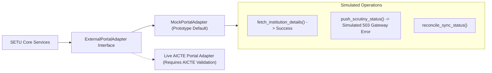

# SETU — External Integration Plan & Portal Adapter Boundary

## 1. External Integration Overview & Boundary

To interface safely with existing AICTE systems without violating security perimeters or assuming undocumented live APIs, SETU implements a strict **Adapter Pattern**.



---

## 2. Adapter Interface Specification (`ExternalPortalAdapter`)

The Python interface `ExternalPortalAdapter` defines the contract:

```python
class ExternalPortalAdapter(ABC):
    @abstractmethod
    def fetch_institution_profile(self, aicte_id: str) -> ExternalInstitutionResponse:
        """Fetch institutional profile from AICTE repository."""
        pass

    @abstractmethod
    def push_approval_decision(self, application_no: str, decision: str, comments: str) -> SyncResult:
        """Publish final approval decision back to national database."""
        pass

    @abstractmethod
    def check_health(self) -> IntegrationHealthStatus:
        """Verify external portal connectivity and API status."""
        pass
```

---

## 3. Mock Implementation (`MockPortalAdapter`)

The mock adapter provides deterministic responses for local demonstration:
1. **Simulated Success:** `fetch_institution_profile("1-100234567")` returns valid synthetic institutional details with HTTP 200 simulation.
2. **Simulated Failure:** Setting `simulate_failure=True` triggers a handled `ExternalPortalTimeoutError` (HTTP 504 simulation) with retry scheduling and error logging.
3. **Audit Trail:** Every adapter dispatch is recorded with correlation IDs and outcome statuses.

---

## 4. Live Integration Prerequisites & Governance (For Production)

For deployment against live AICTE infrastructure:
1. **Authoritative Agreement:** Formal Data Sharing and Service Level Agreement between SETU and AICTE National Bureau.
2. **mTLS / OAuth2:** Mutual TLS authentication with client certificates and API token rotation.
3. **Idempotency Keys:** Mandatory unique transaction IDs to prevent duplicate status submissions.
4. **Reconciliation Mechanism:** Daily scheduled batch reconciliation comparing SETU state hash with AICTE central registry.
5. **Fallback:** Graceful circuit-breaking where failed synchronizations queue in a dead-letter table for administrative review.
