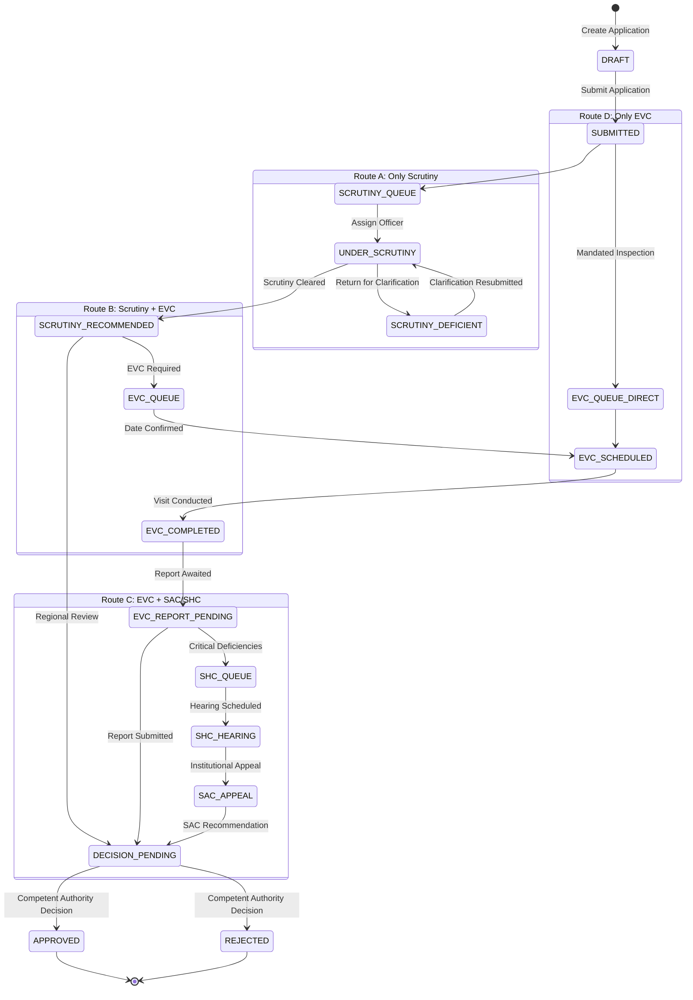

# SETU — Workflow Rules & State Machine Specification

## 1. Demonstrated Route Definitions

SETU models four core processing routes reflecting AICTE Approval Process Handbook (APH) operational pathways:

---

## 2. Stage Details & Standard SLA Windows

| Route | Stage Code | Stage Display Name | Permitted Actor Roles | Default SLA | Successor Stage(s) |
|---|---|---|---|---|---|
| All | `DRAFT` | Draft Application | `INST_ADMIN` | N/A | `SUBMITTED` |
| All | `SUBMITTED` | Submitted / Initial Queue | System | 2 Days | Route Queue |
| A, B | `SCRUTINY_QUEUE` | Awaiting Scrutiny Assignment | `RO_OFFICER`, `BO_OFFICER` | 3 Days | `UNDER_SCRUTINY` |
| A, B | `UNDER_SCRUTINY` | Scrutiny in Progress | `RO_OFFICER`, `COMM_MEMBER` | 7 Days | `SCRUTINY_RECOMMENDED`, `SCRUTINY_DEFICIENT` |
| A, B | `SCRUTINY_DEFICIENT` | Clarification Requested | `INST_ADMIN` | 10 Days | `UNDER_SCRUTINY` |
| A | `SCRUTINY_RECOMMENDED` | Scrutiny Completed | `RO_OFFICER` | 2 Days | `DECISION_PENDING` |
| B, D | `EVC_QUEUE` | Awaiting EVC Scheduling | `EVC_COORD` | 7 Days | `EVC_SCHEDULED` |
| B, D | `EVC_SCHEDULED` | EVC Inspection Scheduled | `EVC_COORD`, Experts | Variable | `EVC_COMPLETED` |
| B, D | `EVC_COMPLETED` | Visit Done / Report Awaited | `EVC_COORD`, Experts | 3 Days | `EVC_REPORT_SUBMITTED` |
| B | `EVC_REPORT_SUBMITTED`| EVC Report Under Review | `RO_OFFICER`, `BO_OFFICER` | 3 Days | `DECISION_PENDING`, `SHC_QUEUE` |
| C | `SHC_QUEUE` | Standing Hearing Committee | `BO_OFFICER`, `COMM_MEMBER` | 10 Days | `SHC_COMPLETED`, `SAC_APPEAL` |
| C | `SAC_APPEAL` | Standing Appellate Committee | `BO_OFFICER`, `COMM_MEMBER` | 14 Days | `DECISION_PENDING` |
| All | `DECISION_PENDING` | Final Competent Decision | `COMP_AUTH` | 5 Days | `APPROVED`, `REJECTED` |
| All | `APPROVED` | Approved | Terminal | N/A | End |
| All | `REJECTED` | Rejected | Terminal | N/A | End |

---

## 3. Transition Guard Rules

1. **Mandatory Return Reason:** Any transition to `SCRUTINY_DEFICIENT` must include non-empty `comments` articulating the deficiency or clarification needed.
2. **Authority Check:** Only users with `COMP_AUTH` role can transition an application from `DECISION_PENDING` to `APPROVED` or `REJECTED`.
3. **Regional Scope Enforcement:** Regional officers can only transition applications originating in their assigned Region.
4. **Resubmission Counter:** Resubmissions increment the application's `return_count`, allowing the Exception Cockpit to flag repeatedly returned applications.
5. **Timeline and Audit Event:** Every state movement writes a row to `application_history` and simultaneously appends a cryptographic hash-chained event to `audit_events`.

